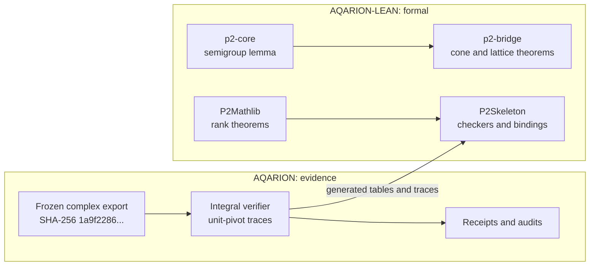

<div align="center">

# AQARION LEAN

**Machine-checkable foundations for finite dynamical systems, partition refinement, and operator-rank methods.**
Built with Lean 4 and Mathlib.

*Prove. Verify. No free parameters.*

[](https://github.com/quantarion369-arch/AQARION-LEAN/actions/workflows/p2-lean.yml)
[](https://github.com/quantarion369-arch/AQARION-LEAN/actions/workflows/p2-bridge.yml)
[](https://github.com/quantarion369-arch/AQARION-LEAN/actions/workflows/p2-skeleton.yml)
[](https://github.com/quantarion369-arch/AQARION-LEAN/actions/workflows/finite-anchor-join.yml)


*Last updated: 2026-11-25*

</div>

---

## PBCore006: successful Lean build

<!-- PBCORE006-BUILD-PASS-20261017 -->
PBCore006 completed `lake build` successfully in Termux / Ubuntu proot on ARM64.

```text
Build completed successfully (785 jobs).
LAKE_EXIT=0
LOG_EXIT=0
BUILD FINISHED SUCCESSFULLY
```

- Resume timestamp: `2026-10-17T22:15:00-04:00`.
- The displayed warnings were non-fatal.
- [Successful build record](RECEIPTS/PBCore006-build-result-20261017.md)
- [Actual console log](RECEIPTS/PBCore006-20261017-console.log)

The console log was copied from the device log with matching SHA-256:

`0ef92b13e35a1785831ede359280b373f8f2dd9043f8e77afd43aa1616d824a1`

This repository contains the current transferable Lean sources, on-device Android ARM64 build
receipts, and consolidated checkpoint documentation for the AQARION Lean work.

## Contents

- `PROJECTS/AQFPR006/`: repaired weighted-Bell / restricted-growth-string artifact.
- `PROJECTS/PB006Audit/`: Lean audit and benchmark artifact.
- `PROJECTS/PBCore006/`: source transferred for build verification and mathematical review.
- `PROJECTS/FiniteAnchorJoinRigidity/`: finite-anchor join rigidity with its own verifier.
- `PROJECTS/TemporalObservability-20261029/`: research and source checkpoint.
- `P2-SEMIGROUP/`: Project 2 formalization (CI-checked lanes).
- `RECEIPTS/`: build logs, hashes, exit codes, and verification receipts.
- `scripts/`: build, audit, and receipt helper scripts.
- `CONSOLIDATED/`: single entry point for the current checkpoint, process, evidence, examples, and script reference.

## Start here

Open:

```text
CONSOLIDATED/CHECKPOINT.md
```

That file contains the current build ledger, verification boundary, and promotion status.

| If you want | Open |
|---|---|
| The device-build checkpoint and promotion status | `CONSOLIDATED/CHECKPOINT.md` and `STATUS.md` |
| The Project 2 formal results and theorem inventory | `P2-SEMIGROUP/REPORT.md` |
| How a unit-pivot trace becomes a rank theorem, and a wording erratum | `P2-SEMIGROUP/TRACE_NOTE.md` |
| CI evidence for Project 2 | `P2-SEMIGROUP/CI_RECEIPT_20261125.json`, `CI_RECEIPT_CURRENT.json`, and the Actions tab |
| How to replay the Project 2 builds | `P2-SEMIGROUP/REPLAY.md` |
| Device build records | `RECEIPTS/` |

## At a glance

| | |
|---|---|
| **Projects** | 5 Lean projects under `PROJECTS/`, plus the Project 2 formalization in `P2-SEMIGROUP/` |
| **Project 2 gated lanes** | `p2-core` (27 axiom reports), `p2-bridge` (33), `P2Mathlib` (3) |
| **Allowed axioms** | `propext`, `Classical.choice`, `Quot.sound` (only `propext` and `Quot.sound` in `p2-core`); no `sorryAx` |
| **Component bindings** | 7 of 9 integral component matrices bound to a generic rank theorem in Lean |
| **Local audit** | All 9 saved traces replay to zero residual; rank equals the pivot count over characteristics 2, 3, 5, 7, 11, 13 and 101 |
| **Overall Project 2 theorem** | `DRAFT_REQUIRING_REVIEW`, with no external review |
| **CI** | 5 workflows; CI is the authoritative Lean checker for Project 2 |

> **Reading rule.** A passing build establishes that the built targets compile under the stated checks.
> It does not by itself establish every mathematical claim, validate all computational evidence, or
> certify publication readiness.

## Platform

The recorded builds were performed on Android using Termux and Ubuntu proot, with native ARM64 Linux
ELF Lean binaries.

| | |
|---|---|
| Lean | 4.35.0-rc3 |
| Lake | 5.0.0 |
| Architecture | aarch64 / ARM64 |
| Execution | native ELF under proot, not CPU emulation |

| Where | Toolchain |
|---|---|
| Device builds (earlier projects) | Android, Termux and Ubuntu proot, ARM64; Lean 4.35.0-rc3 |
| Finite-anchor verification | Lean 4.35.0-rc4 |
| Project 2 CI | GitHub-hosted Linux runners; Lean v4.35.0-rc4 and v4.36.0 for `p2-core`, Lean v4.36.0 with Mathlib v4.36.0 for the Mathlib lanes |

## Reproduce

Each Lean project contains its own lakefile and lean-toolchain. From within a project directory:

```text
lake build
```

To rebuild all projects and record receipts:

```text
./scripts/build-all.sh
```

To inspect proof and computational-check boundaries:

```text
./scripts/audit.sh
```

Project 2 (CI is authoritative; the Mathlib lanes need the Mathlib cache and a desktop-class machine):

    cd P2-SEMIGROUP/p2-core && lake build
    cd P2-SEMIGROUP/p2-bridge && lake exe cache get && lake build
    cd P2-SEMIGROUP/p2-mathlib && lake exe cache get && lake build     # gated P2Mathlib
    cd P2-SEMIGROUP/p2-mathlib && lake build P2Skeleton                # experimental lane

See `P2-SEMIGROUP/REPLAY.md`. Finite-anchor verification:

    bash PROJECTS/FiniteAnchorJoinRigidity/verify.sh
    bash PROJECTS/FiniteAnchorJoinRigidity/verify.sh --check-only

## Status

See `CONSOLIDATED/CHECKPOINT.md` and `STATUS.md`.

AQFPR006, PB006Audit, and PBCore006 have fresh successful builds in the recorded environment.
Mathematical formalization, C4 certification, publication readiness, and promotion remain separate open
obligations. The recorded open item for PBCore006 is its coefficient semantics, including the note that
its exponential generating function should use `P(T(z))`, not `P(T(z)) - 1`.

### How to read a status

| Level | Icon | Meaning | Examples here |
|---|:---:|---|---|
| **Gated** | ✅ | Built in CI with an axiom gate: only `propext`, `Classical.choice`, `Quot.sound` (only `propext` and `Quot.sound` for `p2-core`), no `sorryAx` | `p2-core`, `p2-bridge`, `P2Mathlib` |
| **Built, ungated** | 🟡 | Built in CI, errors fail the job, `sorry` is permitted in that lane only | `P2Skeleton`, `p2-skeleton-cases` |
| **Verified by a project verifier** | 🔧 | A recorded compile and axiom audit, reproducible with the project's own script | `FiniteAnchorJoinRigidity`, the device builds |
| **Computational** | 🔬 | Replayed by scripts with receipts; not Lean | Evidence packages in the AQARION repository |
| **Draft or research** | 📝 | A statement or calculation under review | The Project 2 resolution theorem; the temporal-observability checkpoint |

"CI-reported" means the result is recorded by a GitHub Actions run. No Lean result in this repository has
had external or independent review.

## Projects

| Project | What it is | Recorded status |
|---|---|---|
| 🧮 **`AQFPR006`** | Repaired weighted-Bell / restricted-growth-string artifact | Rebuilt on device; passes its recorded finite anchors; Gate 2 rejects the tested gcd-to-lcm mutation |
| 📊 **`PB006Audit`** | Lean audit and benchmark artifact | Rebuilt on device |
| ⚙️ **`PBCore006`** | Source transferred for build verification and mathematical review | Build pass on device (785 jobs); coefficient semantics remain open |
| 🔗 **`FiniteAnchorJoinRigidity`** | Join of finite chains with generator inclusion, leastness, forward preservation and finite-anchor join rigidity | Fresh compile and four-declaration axiom audit passed (Lean 4.35.0-rc4); own CI workflow |
| 🌀 **`TemporalObservability-20261029`** | Research and source checkpoint with a twelve-cycle computation | Not a Lean build |
| 🧱 **`P2-SEMIGROUP`** | Project 2 formalization | Partly gated; overall theorem is a draft |

<details>
<summary><b>Finite-anchor join rigidity</b></summary>

The join is constructed from finite chains. Generator inclusion, leastness, forward preservation and
finite-anchor join rigidity are formalized. Only the selected anchor requires an explicitly finite
quotient and backward stability; every generator is assumed forward-preserved, and neither the state
type nor the indexing family is assumed finite.

A fresh compile with Lean 4.35.0-rc4 passed, with the join importing the freshly compiled anchor, and
four declaration reports matched:

| Declaration | Reported axioms |
|---|---|
| Finite-quotient rigidity | `propext`, `Classical.choice`, `Quot.sound` |
| Finite-anchor rigidity | `propext`, `Classical.choice`, `Quot.sound` |
| Join universal property | none |
| Finite-anchor join rigidity | `propext`, `Classical.choice`, `Quot.sound` |

None reports `sorryAx`. This is selected-declaration formal checking, not novelty review or an audit of
every declaration, and the separate Mathlib rewrite is not checked. The `finite-anchor-join` workflow
uses the same verifier; the project's own note says the bootstrap and action major-version tags are
mutable references, so this is not a hermetic supply-chain attestation. See
`PROJECTS/FiniteAnchorJoinRigidity/VERIFICATION.md`.

</details>

<details>
<summary><b>Temporal observability checkpoint</b></summary>

This folder is a research and source checkpoint, not a Lean build receipt. It holds copies of earlier
local certificate, checkpoint, rank-module and finite-bridge text artifacts (with hashes), and a
transcription of a twelve-cycle calculation:

| Item | Value |
|---|---|
| Word | `000000101101` |
| Transition | `T(i) = (i + 1) mod 12` |
| Ordered basis | 12 elements: `1`, `f0` to `f5`, and the products `f0*f1`, `f0*f2`, `f0*f3`, `f1*f2`, `f1*f3` |
| Determinant of the basis | -1 |
| Minimum consecutive horizon | 6, with minimum degree 2 at that horizon |

That calculation was transcribed from a chat session and was not rerun by the publication script; copied
files may contain failed attempts and superseded revisions. No source-to-artifact correspondence theorem,
general JSON acceptance theorem or infinite-span Lean formalization is claimed, and nothing in the folder
is wired into the project builds.

</details>

## Architecture

Project 2 is split across two repositories on purpose: evidence on one side, formal proof on the other.



## Project 2: characteristic-uniform resolution

Project 2 studies a draft theorem about a five-map graded complex (maps **D1 to D5**) on ten variables
(**A, E0 to E3, B0 to B3, C**, with weights 1 and 2): that it is a resolution over **every coefficient
field**, with integral components whose ranks are certified by unit-pivot elimination. The work splits
into formal geometry, formal rank certificates, and computational evidence. This repository holds the
first two. The evidence lives in the [AQARION](https://github.com/quantarion369-arch/AQARION) repository.

### Formal lanes

| Lane | Folder | Toolchain | Gate | Contents |
|---|---|---|---|---|
| ✅ `p2-core` | `P2-SEMIGROUP/p2-core` | Lean v4.35.0-rc4 and v4.36.0, no Mathlib | Exactly 27 axiom reports, none outside `propext` and `Quot.sound`, no `sorryAx`; two negative controls must be rejected | Integer semigroup-generation lemma, facets, arithmetic kernel |
| ✅ `p2-bridge` | `P2-SEMIGROUP/p2-bridge` | Lean v4.36.0 with Mathlib; `p2-core` as a local dependency | Exactly 33 axiom reports from the allowed set; no `sorryAx`; no `declaration uses` warning | Closure, cone-interior, real-point translation and generated-cone theorems |
| ✅ `P2Mathlib` | `P2-SEMIGROUP/p2-mathlib` | Lean v4.36.0 with Mathlib v4.36.0 | Exactly 3 axiom reports from the allowed set; no `sorryAx`; no `declaration uses` warning | Ring smoke test; `rank_of_unit_pivot_normal_form`; `rank_of_unitTrace` |
| 🟡 `P2Skeleton` | `P2-SEMIGROUP/p2-mathlib` | Same as `P2Mathlib` | None (build errors fail the job; `sorry` is permitted only here) | Row-trace theorem, dense and sparse trace checkers, concrete bindings |

### Rank certificates

`rank_of_unitTrace` states that an integer matrix with a valid unit-pivot trace of length `r` has rank `r`
over every field. A trace is a list of pivots, each a plus or minus one entry. Each step clears the
pivot's column from the remaining rows and removes the pivot row; the trace is valid when everything that
remains is zero.

```text
M'[a][b] = M[a][b] - M[a][j] * M[i][j] * M[i][b]      (pivot at row i, column j, with M[i][j] = +1 or -1)
```

**Worked example: D2 in degree 4.** The matrix has 46 rows and 3 columns. Its saved trace is `(9, 0)`,
`(14, 1)`, `(19, 2)`, with every pivot entry equal to -1. Clearing each pivot column leaves all remaining
rows zero, so the rank is 3 over every field.

A wording erratum about "row/column operations" and "Smith form" in the original verifier text is
recorded in `P2-SEMIGROUP/TRACE_NOTE.md`. The conclusions are unchanged, and the Smith-invariant remark
made there is a mathematical argument that is not formalized. A row-native version, `rank_of_rowTrace`,
mirrors the verifier's replay directly. Two checkers prove soundness once and are then evaluated by the
Lean kernel on concrete tables, without `native_decide`:

| Checker | Rows stored as | Theorem |
|---|---|---|
| Dense | Full lists of integers | `rank_of_check` |
| Sparse | Lists of (column, value) pairs, compacted after each update | `rank_of_checkS` |

### Component bindings

Each row is one integral component matrix generated by the verifier from a frozen export
(SHA-256 `1a9f22866a38f135859a41616f18a5756e7fdecc921a2f36b078c20db334a8a0`). Its rank equals the number of
unit pivots.

| Map | Degree | Rows x columns | Rank | Bound in Lean (CI-reported, ungated lane) | Checker |
|---|---|---|---|:---:|---|
| D2 | 4 | 46 x 3 | 3 | ✅ | Dense, plus a hand-written proof |
| D2 | 5 | 190 x 39 | 39 | ✅ | Dense and sparse |
| D2 | 6 | 600 x 188 | 180 | ✅ | Sparse |
| D3 | 6 | 188 x 8 | 8 | ✅ | Dense |
| D3 | 7 | 700 x 64 | 64 | ✅ | Dense |
| D3 | 8 | 2080 x 283 | 277 | ⏳ | Not bound: the CI runner terminated during kernel evaluation |
| D3 | 9 | 5448 x 975 | 937 | ⏳ | Not bound: the CI runner terminated during kernel evaluation |
| D4 | 8 | 283 x 6 | 6 | ✅ | Dense |
| D4 | 9 | 975 x 38 | 38 | ✅ | Dense |

All nine also pass an independent local audit: the saved trace replays to zero residual, and the rank over
characteristics 2, 3, 5, 7, 11, 13 and 101 equals the pivot count. The two unbound cases rest on that
audit alone. A different certificate shape, explicit combinations of pivot rows, is the planned way to
close them.

## Continuous integration

| Workflow | Builds | Asserts |
|---|---|---|
| `p2-lean` | `p2-core` on Lean v4.35.0-rc4 and v4.36.0; the `p2-mathlib` default library | 27 reports and two failing negative controls for `p2-core`; 3 reports for `P2Mathlib` |
| `p2-bridge` | `p2-bridge` | 33 reports, no `sorryAx`, no `declaration uses` |
| `p2-skeleton` | `P2Skeleton` root | Build success only; prints axiom lines |
| `p2-skeleton-cases` | Selected large case modules, one parallel job each | Build success per case; prints axiom lines |
| `finite-anchor-join` | `PROJECTS/FiniteAnchorJoinRigidity` through its `verify.sh` | Source hashes, compiler pin, fresh compile and the axiom audit described above |

Receipts are additive: `CI_RECEIPT.json` (early scope, preserved), `CI_RECEIPT_CURRENT.json`, and
`CI_RECEIPT_20261125.json`.

## Trust boundaries

**Not established:**

- The tables are generated by verifier code. The construction of the complex and its matrices is not proved in Lean.
- Lemma 2 (the endpoint presentation over every coefficient field), kernel generation, the D4 and D5 tail, and the cited canonical-module and Betti-duality results are not formalized.
- D3 in degrees 8 and 9 are not bound in Lean.
- The overall resolution theorem remains `DRAFT_REQUIRING_REVIEW`.
- No result has had external or independent review.
- The skeleton lanes are not axiom-gated, so a green skeleton build is not a gated result.

| Check | It establishes | It does not establish |
|---|---|---|
| Gated lane green | The gated modules compile, and every reported axiom is in the allowed set | Any claim beyond the declared theorem statements |
| Skeleton lane green | The modules compile; the printed axiom lines are as reported | A gate; promotion to a gated result |
| Local audit pass | The saved data replays and ranks agree over the listed fields | A Lean proof |
| Device build pass | The target compiled in the recorded environment | General mathematical correctness |

## Roadmap

- [x] Semigroup and cone bridge theorems in a gated lane (`p2-bridge`)
- [x] Generic unit-pivot trace-rank theorem in a gated lane (`P2Mathlib`)
- [x] Row-native trace theorem and two checkers with proved soundness
- [x] 7 of 9 component matrices bound to the generic theorem
- [ ] Bind D3 in degrees 8 and 9 (planned: explicit combinations of pivot rows)
- [ ] Promote the concrete bindings into a gated lane
- [ ] Lemma 2: endpoint presentation over every coefficient field
- [ ] Kernel generation and the D4 and D5 tail
- [ ] Prove the construction of the matrices from the complex
- [ ] Independent review of the assembled resolution argument

## The AQARION ecosystem

| Repository | Role |
|---|---|
| **[AQARION-LEAN](https://github.com/quantarion369-arch/AQARION-LEAN)** | Lean sources, formal verification, and build receipts |
| **[AQARION](https://github.com/quantarion369-arch/AQARION)** | Research artifacts, computational evidence, and provenance |
| **[Aqarion-Fastapi](https://github.com/quantarion369-arch/Aqarion-Fastapi)** | API and operational integration |

These repositories have distinct responsibilities. A successful Lean build establishes compilation success
for the built targets; it does not, by itself, establish every mathematical claim, validate all
computational evidence, or certify publication readiness.

## Conventions

- For Project 2, CI is the authoritative Lean checker. Mathlib-based builds are not supported in Termux.
- Receipts are additive. Historical receipts and evidence bundles are preserved, and new receipts are added beside them.
- Lean data files generated from verifier output record the source hash of the frozen export.
- A computational receipt is not a theorem, and a green skeleton build is not a gated result.
